<div align="center">


<a href="https://github.com/Matheusvc">
  
</a>

<p>
  <a href="https://www.linkedin.com/in/matheus-lira-a01288364"></a>
  <a href="https://wa.me/5598987577739"></a>
  <a href="mailto:matheusvitorcl1@gmail.com"></a>
  <a href="https://github.com/Matheusvc/portfolio"></a>
  
</p>

</div>

## 👨‍💻 Sobre mim

```ts
const matheus = {
  cargo: 'Analista de Sistemas & Desenvolvedor Full-Stack',
  local: 'São Luís, MA 🇧🇷',
  formacao: ['Engenharia de Software', 'Análise e Desenvolvimento de Sistemas'],
  foco: ['APIs REST', 'regras de negócio', 'integrações', 'automação de processos'],
  agora: 'Transformando processos manuais e dados dispersos em sistemas',
  aberto: ['freelance', 'colaborações'],
};
```

- 🧩 Desenvolvo **back-end com Java e Spring Boot**: APIs REST, regras de negócio e integração entre serviços.
- 🗄️ Modelo e consulto dados em **SQL e PostgreSQL**.
- ⚙️ Crio **automações com n8n**, conectando APIs, webhooks e bancos para eliminar trabalho manual.
- 🎨 No front-end, construo interfaces com **React, TypeScript e Tailwind**, como o meu [portfólio](https://github.com/Matheusvc/portfolio).

## 🧰 Stack

<table align="center">
  <tr>
    <td align="center" width="170"><b>Back-end</b></td>
    <td></td>
  </tr>
  <tr>
    <td align="center"><b>Front-end</b></td>
    <td></td>
  </tr>
  <tr>
    <td align="center"><b>Dados</b></td>
    <td></td>
  </tr>
  <tr>
    <td align="center"><b>DevOps & ferramentas</b></td>
    <td></td>
  </tr>
  <tr>
    <td align="center"><b>Automação & IoT</b></td>
    <td>
      
      
      
    </td>
  </tr>
</table>

## 📊 GitHub em números

<div align="center">
  
  
  <br />
  
</div>

## 🚀 Projetos em destaque

<div align="center">
  <a href="https://github.com/Matheusvc/portfolio"></a>
  <a href="https://github.com/Matheusvc/painel-gestao-juridica"></a>
  <a href="https://github.com/Matheusvc/entregavel-java"></a>
  <a href="https://github.com/Matheusvc/entregavel-banco"></a>
</div>

## 🐍 Contribuições

<picture>
  <source media="(prefers-color-scheme: dark)" srcset="https://raw.githubusercontent.com/Matheusvc/Matheusvc/output/github-snake-dark.svg" />
  
</picture>

<div align="center">

**Disponível para projetos freelance e colaborações.**


</div>
